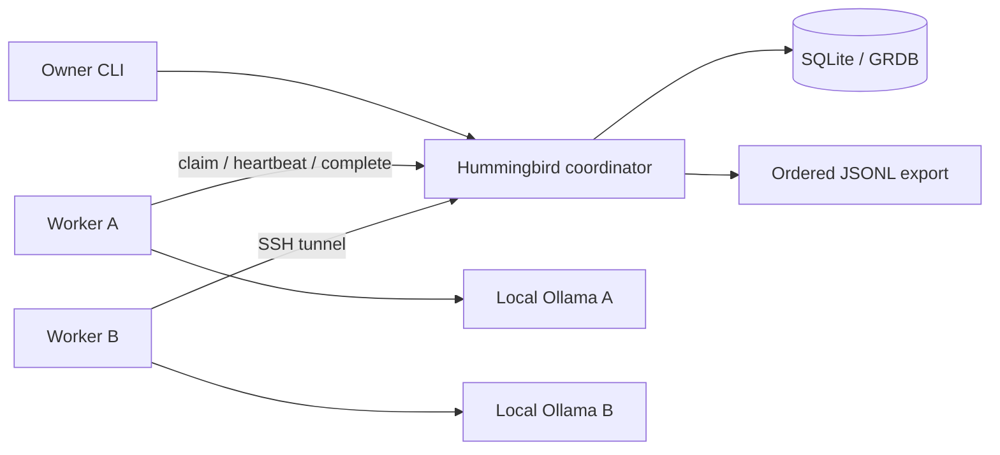

# BatchDock

Recoverable JSONL inference batches using participating Macs and their local Ollama models. Submit a dataset once, let compatible workers pull independent prompts, and export one ordered outcome per input—even after interruptions.

**Status:** working command-line MVP. Real inference is verified on one Mac; multi-Mac execution and throughput remain unmeasured.

## Why it exists

Splitting a dataset across inference scripts also creates work: tracking unfinished inputs, retrying failures, rejecting late results, and merging outputs. BatchDock makes that recovery workflow explicit. It targets trusted collaborators with models already installed. Every prompt runs entirely on one worker; models are not split across machines.

## High-level architecture



One coordinator owns the durable queue. Workers pull one compatible job at a time and execute inference outside database transactions. The coordinator listens on loopback; another Mac uses an existing SSH connection to forward that endpoint. Worker owners can inspect prompts and outputs, so participation assumes trust.

## Execution and recovery design

1. **Submit:** validate the manifest and JSONL, preserve input order, and atomically insert the batch. A persisted request UUID makes an uncertain submission safe to retry; changed input under the same key conflicts.
2. **Claim:** a SQLite transaction assigns one job, increments its generation, and records the claim identity. A partial unique index enforces one active attempt per worker across process incarnations.
3. **Execute:** the worker checks the exact model digest and Ollama version, runs inference, and renews ownership through independent heartbeats. Ownership uses monotonic deadlines rather than wall-clock time.
4. **Commit:** the worker saves an immutable completion spool before sending. The coordinator checks the attempt, epoch, generation and worker incarnation, then commits the result and job transition together. Identical retries replay; changed payloads conflict.
5. **Recover:** expired work can be reassigned within a three-attempt budget. Restart advances the coordinator epoch and invalidates unfinished old attempts. Accepted results survive. Failure reports have durable replay receipts too.

This permits repeated computation while accepting at most one result per input. It does not promise exactly-once inference execution. Cancellation preserves existing successes and invalidates unfinished work.

### Source map and persistence

| Module | Responsibility |
| --- | --- |
| [BatchDockCore](Sources/BatchDockCore) | Codable contracts, validation, canonical hashes and errors |
| [BatchDockStore](Sources/BatchDockStore) | SQLite migrations, transactional ownership, recovery and export |
| [BatchDockServer](Sources/BatchDockServer) | Authenticated HTTP routes, bootstrap and exclusive coordinator lock |
| [BatchDockWorker](Sources/BatchDockWorker) | Ollama adapter, heartbeat watchdog, protected state and completion replay |
| [batchdock](Sources/batchdock) | ArgumentParser owner and worker commands |

SQLite uses foreign keys, WAL and FULL synchronous mode. `batches` stores submission identity and immutable configuration; `jobs` stores ordered input and current state; `attempts` and `claims` track ownership; `results` and `failure_receipts` make outcomes replayable. Worker credentials are stored as hashes. Live lease deadlines and retry delays stay in memory; restart fences leases without resetting persisted attempt budgets.

Work routes cover batch submission/status/cancellation/export, worker enrollment/revocation, and claim/heartbeat/completion/failure. Owner and worker credentials have separate permissions. See [wire types](Sources/BatchDockCore/Protocol.swift) and [routes](Sources/BatchDockServer/Server.swift) for the exact contract.

## Quick start

Requires Swift 6.2+, macOS 14+, and a running Ollama instance with an installed model.

```sh
swift build
swift run batchdock init
swift run batchdock doctor --model gemma2:2b --write-manifest .batchdock/manifest.json --max-output-tokens 32
```

Start `swift run batchdock serve` in another terminal. Then enroll a worker, submit the sample inputs, and run it:

```sh
swift run batchdock worker add --name mac-a --write-token .batchdock/mac-a.token
swift run batchdock submit --manifest .batchdock/manifest.json --input Fixtures/prompts.jsonl
swift run batchdock worker run --token-file .batchdock/mac-a.token --stop-when-idle
swift run batchdock status <batch-id>
swift run batchdock export <batch-id> --output .batchdock/results.jsonl --require-success
```

Use an exact installed model tag. Repeating an identical submission reuses its saved request identity; pass a new `--request-id` to intentionally create a new run.

Each worker has its own credential. Remote workers reach the loopback coordinator through an SSH forward; models stay on each worker. Each job runs entirely on one Mac.

## Validation and reproduction

| Check | What actually passed |
| --- | --- |
| `swift test -j 4` | 16 tests covering ownership races, remaining lease on replay, stale results, restart fencing, cancellation, attempt budgets, authentication, strict input, export bounds and durable failure replay |
| `python3 scripts/acceptance.py` | Real coordinator over HTTP with synthetic protocol workers: competing claims, submission/completion replay conflicts, lease expiry, SIGKILL restart, durable output and complete ordered cancellation export |
| `python3 scripts/worker-retry.py` | Actual CLI and worker against a simulated Ollama endpoint returning one HTTP 503; worker retries and exports one accepted result |
| `sh scripts/smoke-ollama.sh gemma2:2b` | Actual local Ollama: three fixture prompts completed through submission, worker processing, successful status and ordered export |

The real-model check ran locally with an installed `gemma2:2b`; it installs no models and requires a running coordinator. The HTTP workers and transient-failure endpoint are simulations, not inference benchmarks. CI repeats the unit, HTTP and transient-worker checks without requiring Ollama. [Verified implementation CI run](https://github.com/rohanshinde24/BatchDock/actions/runs/45174925672).

## Limits and next steps

- One coordinator; restart recovery is implemented, high availability is not.
- Import limits: 10,000 records, 50 MiB total, 32,000 UTF-8 bytes per prompt. Output is limited to 256 KiB per item and attempts to 600 seconds.
- Export buffers a snapshot with a conservative 64 MiB worst-case JSON preflight. It may reject an actual ASCII export smaller than that; split batches until streaming is implemented.
- No native dashboard, automatic discovery, public workers or model downloads.
- Next validation: two physical Macs over SSH, interrupted-worker recovery on that setup, a tuned single-Mac versus multi-Mac benchmark, and an actual collaborator pilot. No speedup or user-adoption result is claimed.

## Production roadmap

The next phase is planned, with implementation paused. See [production milestones and acceptance criteria](ROADMAP.md) for operability, fault campaigns, physical multi-Mac benchmarks, resource controls and independent pilot gates. These are planned acceptance targets, not delivered production claims.
